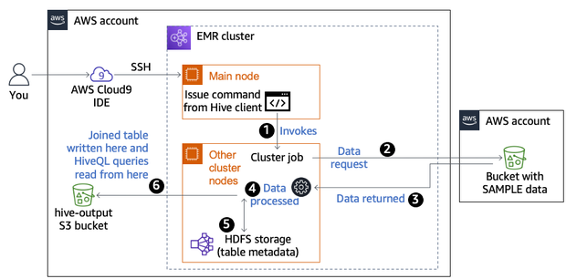
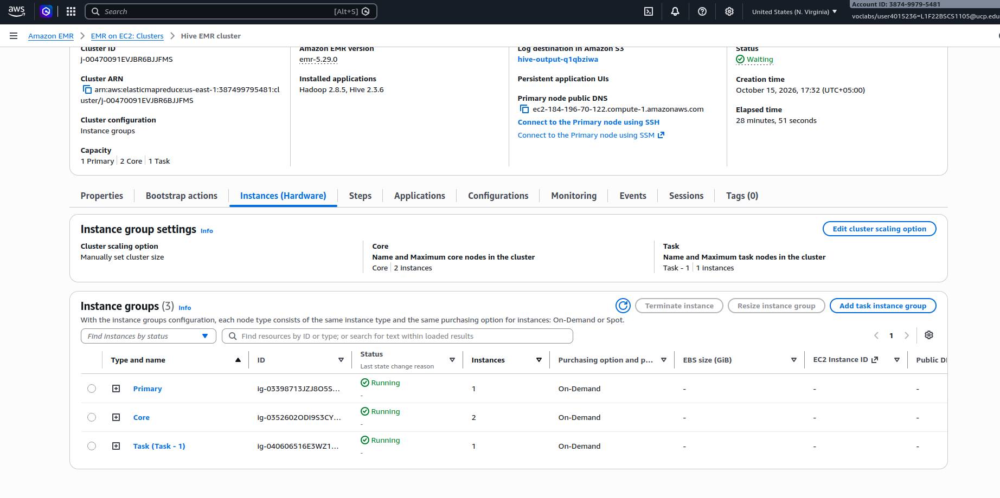
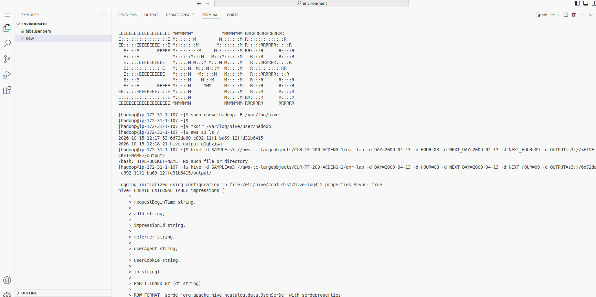
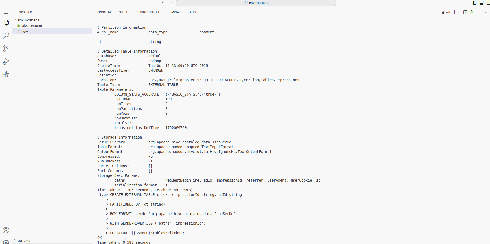
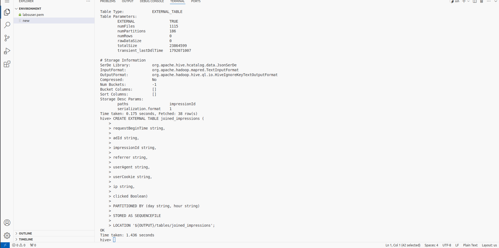
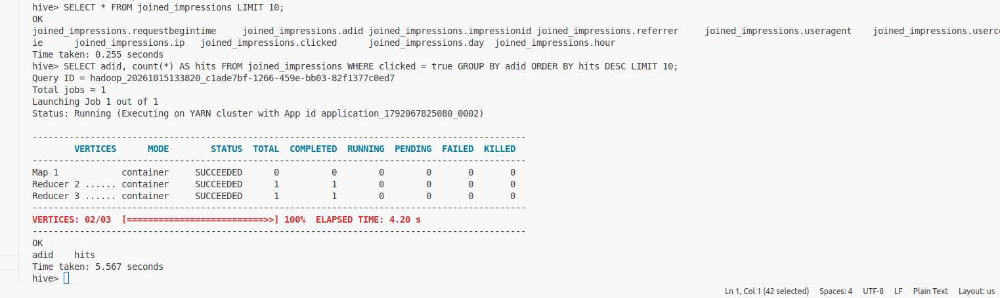

# AWS EMR Hive Log Analytics

## Project Overview

This project demonstrates how to process and analyze large-scale advertising log data using **Amazon EMR, Apache Hive, and Amazon S3**.

The project focuses on combining advertising impression logs with click logs to identify which advertisements received the most clicks and which referring websites generated the most engagement.

Apache Hive is used to create external tables, discover data partitions, transform records, join datasets, and execute analytical queries on data stored in Amazon S3.

## Objectives

- Launch an Amazon EMR cluster with Hadoop and Hive.
- Create Hive external tables referencing JSON log data in Amazon S3.
- Discover and register existing data partitions.
- Transform advertising logs using HiveQL.
- Join impression and click records to identify successful ad interactions.
- Analyze the most-clicked advertisements and top referring websites.
- Store the processed dataset in Amazon S3 for subsequent analysis.

## Architecture

The project follows this data processing workflow:

```text
Advertising Impression Logs ──┐
                               │
                               ▼
                         Amazon S3
                               ▲
                               │
Advertising Click Logs ────────┘
                               │
                               ▼
                         Amazon EMR
                      (Hadoop + Hive)
                               │
                               ▼
                      External Hive Tables
                    (Impressions and Clicks)
                               │
                               ▼
                     Data Transformation
                      and Preparation
                               │
                               ▼
                      LEFT OUTER JOIN
                               │
                               ▼
                    Joined Advertising Data
                               │
                               ▼
                         Amazon S3
                               │
                               ▼
                       HiveQL Analytics
                               │
                 ┌─────────────┴─────────────┐
                 ▼                           ▼
          Most-Clicked Ads            Top Referrers
```

The source logs reside in Amazon S3. Hive queries run on Amazon EMR, and the joined dataset is stored in an S3 output location.

 ```markdown
 
 ```

## Technologies Used

| Technology | Purpose |
|---|---|
| Amazon EMR | Provides the distributed processing environment. |
| Apache Hadoop | Supports distributed data processing and cluster resource management. |
| Apache Hive | Enables SQL-like querying and transformation of log data. |
| Amazon S3 | Stores source logs and the processed output dataset. |
| HiveQL | Defines tables, discovers partitions, joins datasets, and performs analysis. |
| HDFS | Stores intermediate data in temporary Hive tables during processing. |
| JSON SerDe | Enables Hive to interpret the source JSON log records. |
| SequenceFile | Stores intermediate and joined data in a Hadoop-native format. |

## Dataset

The project uses two types of advertising logs.

### 1. Impression Logs

Impression logs represent advertisements displayed to users.

The `impressions` table extracts the following fields:

- `requestBeginTime`
- `adId`
- `impressionId`
- `referrer`
- `userAgent`
- `userCookie`
- `ip`

The table is partitioned by `dt`, representing the date and time associated with the source log partitions.

### 2. Click Logs

Click logs record advertising interactions.

The `clicks` table extracts:

- `impressionId`
- `adId`

This table is also partitioned by `dt`.

The `impressionId` field connects click events to the corresponding advertisement impressions.

## Implementation

### 1. Launch the Amazon EMR Cluster

Launch an EMR cluster with Hadoop and Hive installed.

The lab uses a historical EMR configuration with Hadoop 2.8.5 and Hive 2.3.6.

The cluster provides the environment required to execute Hive queries and process the advertising logs.

### 2. Create External Hive Tables

Create the `impressions` and `clicks` external tables.

These tables reference existing JSON data in Amazon S3 rather than copying the original source files into HDFS.

Hive uses the JSON SerDe to interpret the source records.

### 3. Discover Data Partitions

Run `MSCK REPAIR TABLE` to discover existing Hive-compatible partitions in Amazon S3 and register them in Hive metadata.

```sql
SET hive.msck.path.validation=ignore;

MSCK REPAIR TABLE impressions;

MSCK REPAIR TABLE clicks;
```

Partitioning allows Hive to organize records by time and restrict queries to relevant data partitions when appropriate.

### 4. Prepare the Data

Create temporary tables named `tmp_impressions` and `tmp_clicks`.

Use `INSERT OVERWRITE` queries to prepare the records for the selected time interval.

The impression preparation query converts the millisecond timestamp into a readable timestamp:

```sql
FROM_UNIXTIME(
    CAST(
        (CAST(requestBeginTime AS BIGINT) / 1000)
        AS INT
    )
)
```

The click preparation query includes an additional 20-minute window beyond the impression interval to account for clicks occurring after an advertisement is displayed.

The temporary tables use SequenceFile storage.

### 5. Join Impressions and Clicks

Create the `joined_impressions` external table in the S3 output location.

Use a `LEFT OUTER JOIN` on `impressionId` to preserve all selected impression records, including those without matching clicks.

```sql
INSERT OVERWRITE TABLE joined_impressions
PARTITION (
    day='${DAY}',
    hour='${HOUR}'
)
SELECT
    i.requestBeginTime,
    i.adId,
    i.impressionId,
    i.referrer,
    i.userAgent,
    i.userCookie,
    i.ip,
    (c.impressionId IS NOT NULL) AS clicked
FROM tmp_impressions i
LEFT OUTER JOIN tmp_clicks c
    ON i.impressionId = c.impressionId;
```

The resulting dataset includes a Boolean `clicked` field:

- `TRUE`: A matching click record was found.
- `FALSE`: No matching click record was found.

The output table is partitioned by `day` and `hour`.

### 6. Analyze the Joined Dataset

After processing the logs, use HiveQL to investigate advertising performance.

#### Preview the processed records

```sql
SELECT *
FROM joined_impressions
LIMIT 10;
```

#### Identify the most-clicked advertisements

```sql
SELECT
    adId,
    COUNT(*) AS hits
FROM joined_impressions
WHERE clicked = TRUE
GROUP BY adId
ORDER BY hits DESC
LIMIT 10;
```

This query identifies advertisements with the highest number of matching click records in the processed dataset.

#### Identify the top referring websites

```sql
SELECT
    referrer,
    COUNT(*) AS hits
FROM joined_impressions
WHERE clicked = TRUE
GROUP BY referrer
ORDER BY hits DESC
LIMIT 10;
```

This query identifies referring websites associated with the highest number of clicks.

## Repository Structure

```text
aws-emr-hive-log-analytics/
│
├── README.md
│
├── queries/
│   └── hive_queries.hql
│
├── architecture/
│   └── architecture-diagram.png
│
└── screenshots/
    ├── 01-emr-cluster-configuration.png
    ├── 02-emr-cluster-running.png
    ├── 03-hive-impressions-table.png
    ├── 04-hive-clicks-table.png
    ├── 05-table-partitions.png
    ├── 06-joined-impressions-table.png
    ├── 07-ad-click-analysis.png
    ├── 08-top-referrers-analysis.png
    └── 09-output-data-in-s3.png
```

Only include files and screenshots that you have actually created. The architecture diagram is optional until you create your own.

## Screenshots

Screenshots can be added here to document the implementation and results.

### EMR Cluster



### Hive Table Creation





### Joined Dataset



### Advertising Analysis




### S3 Output


> Remove or comment out any image reference until the corresponding screenshot exists in your repository. Otherwise, GitHub will display a broken image.

## Key Learnings

This project demonstrates practical exposure to:

- Distributed data processing with Amazon EMR and Hadoop.
- Querying large datasets using Apache Hive and HiveQL.
- Creating external tables over data stored in Amazon S3.
- Discovering and managing Hive table partitions.
- Transforming JSON log records into structured datasets.
- Using temporary tables to prepare data for further processing.
- Joining datasets using a shared identifier.
- Using Boolean flags to identify records with matching click events.
- Storing processed data in Amazon S3.
- Performing analytical queries to identify advertising engagement trends.

## Project Context

This project is based on an AWS Academy lab focused on processing logs with Amazon EMR.

The repository documents the architecture, Hive queries, and implementation evidence relevant to the project. It is intended as a learning and portfolio project rather than a production-ready advertising analytics platform.

## Author

**Umair Farooq**

- GitHub: [umair9211](https://github.com/umair9211)
- LinkedIn: [Umair Farooq](https://linkedin.com/in/umair-farooq-6ab9b2201)
